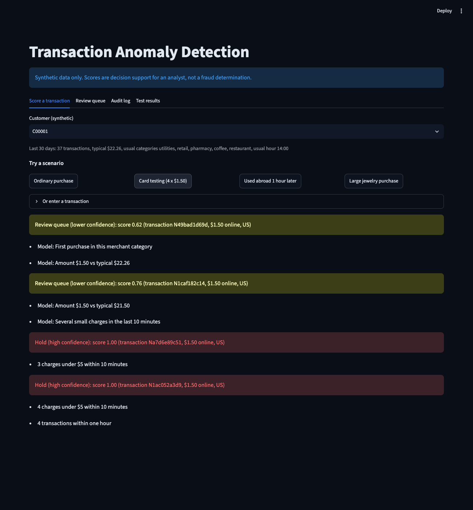
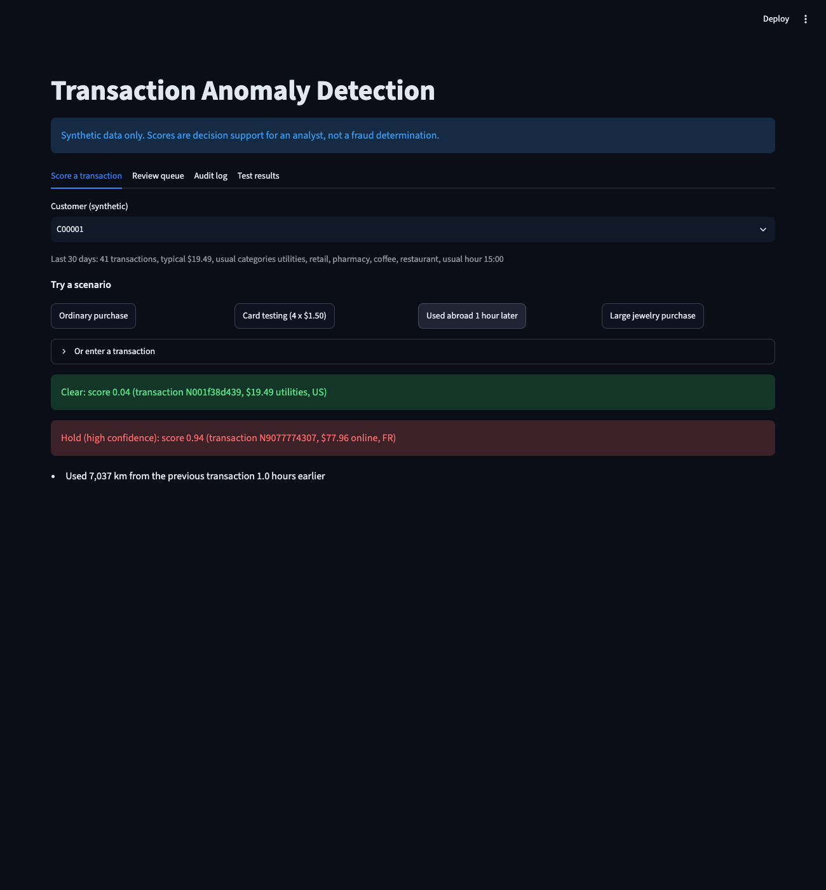
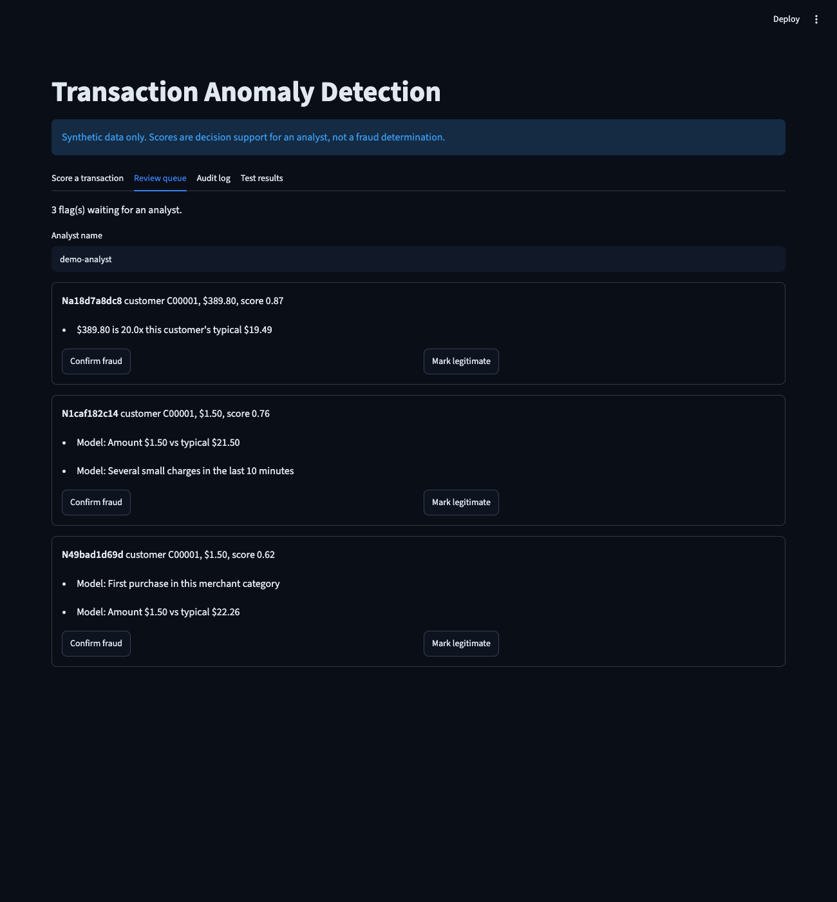
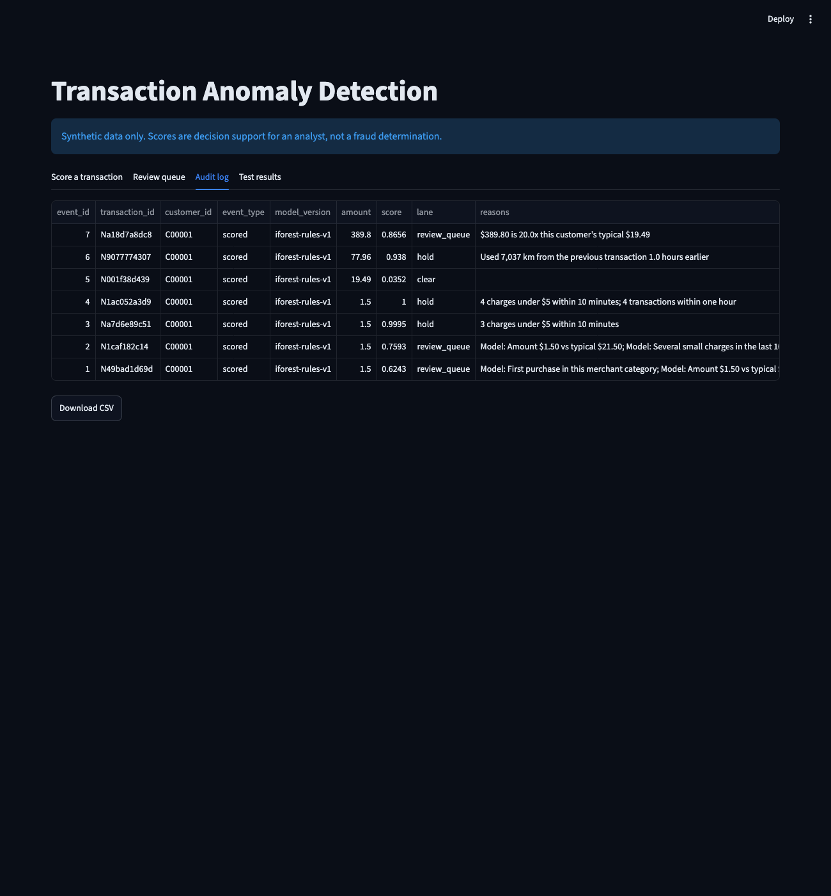
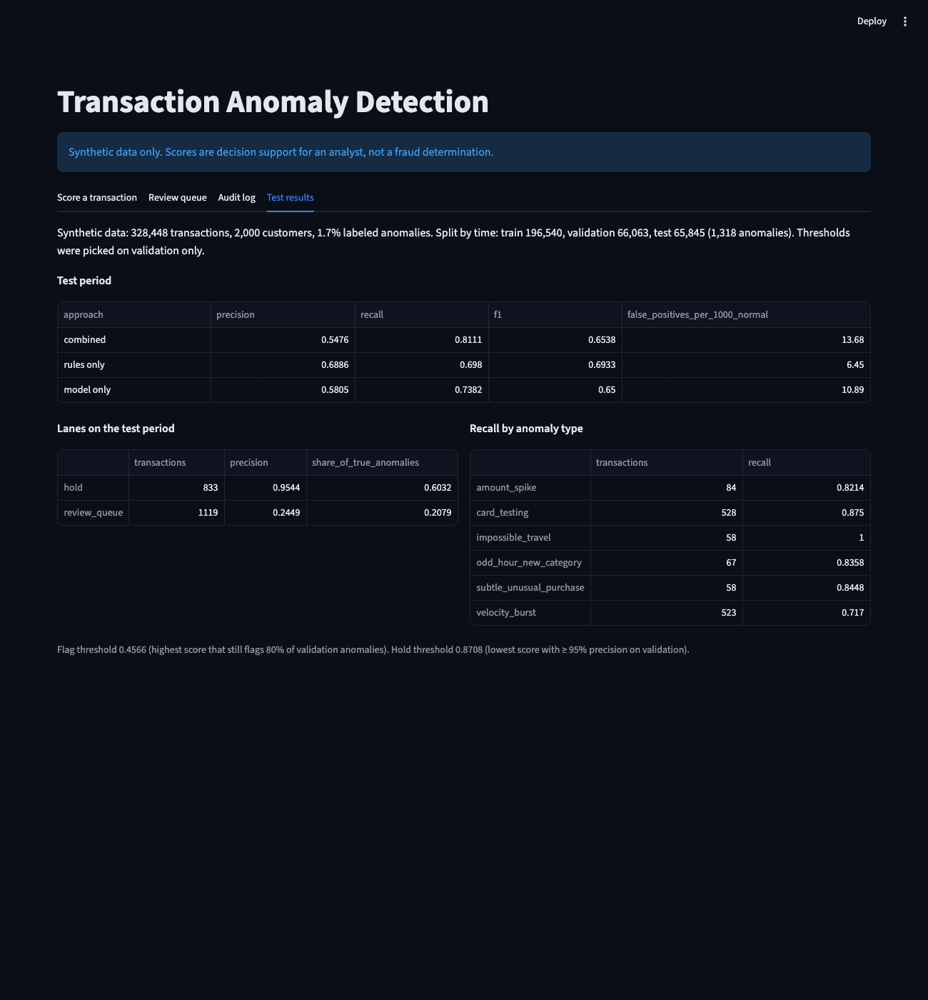

# Transaction Anomaly Detection


**Status: Live.** Demo: https://financial-anomaly-detection.streamlit.app (checked 2026-11-16; the
free Streamlit host puts it to sleep when idle and it wakes on the first visit). The detector, review
queue, audit log, Streamlit app and MCP server also run locally; the MCP server is not hosted.

Independent reference project by Shoot It Analytics LLC. Built with public or synthetic data.

## What it does

1. Scores each card transaction against that customer's own history using an Isolation Forest model
   and five plain rules (amount spike, impossible travel, card testing, velocity, night purchase in a
   new category).
2. Combines model and rules into one score from 0 to 1 and gives every flag a reason a person can
   read, for example "4 charges under $5 within 10 minutes" or "Used 7,037 km from the previous
   transaction 1.0 hours earlier".
3. Routes each transaction to one of three lanes: **clear**, **review queue** (flagged, lower
   confidence, a person decides) or **hold** (flagged, high confidence).
4. Writes every score and every analyst decision to an append-only audit log.
5. Exposes the same functions through a read-only FastMCP server so an AI assistant can score
   transactions, read the queue and read each transaction's audit trail.

All data is synthetic and generated by this repo.



| Impossible travel | Review queue |
|---|---|
|  |  |

| Audit log | Test results |
|---|---|
|  |  |

## Case study

**Transaction Anomaly Detection.** Scores card transactions against each customer's own history with an Isolation Forest and five plain rules, gives every flag a reason a person can read, and splits flags into a hold lane and an analyst review queue.

Status: **Live** · [Live app](https://financial-anomaly-detection.streamlit.app) · [GitHub](https://github.com/johnathan-horner/financial-anomaly-detection) · [Portfolio](https://portfolio.johnathancloudspace.com/#financial-anomaly-detection)

### Real-world problem

Consumers reported $15.9 billion in fraud losses to the FTC in 2025, up from over $12 billion in 2024 ([Federal Trade Commission](https://www.ftc.gov/news-events/news/press-releases/2026/03/ftc-testifies-joint-economic-committee-agencys-efforts-combat-fraud)). Fraud teams work from alert queues where rules are easy to explain but narrow, models catch more but are hard to explain, and both produce more alerts than a team can read.

### Why I built it

I wanted to see whether a small, explainable detector could split alerts into a high-precision lane that is safe to act on and a lower-confidence lane for people, with a reason on every alert, measured on a later period it was not tuned on.

### Version 1

The first version was a design for Kinesis streaming into a PyTorch autoencoder on SageMaker, with a LangGraph investigation agent on ECS Fargate calling Bedrock and DynamoDB and SQS around it, while the prototype ran on mock data and its MCP tools returned random numbers. I rebuilt it in October 2026 as a detector that runs on a CPU, gives a reason for every flag, and is measured on a later period it was not tuned on.

### Key decisions

- **Isolation Forest plus five plain rules, not a supervised model or an LLM.** It needs no fraud labels to train, runs on a CPU, and each rule gives a sentence a person can read. Labels are still needed to calibrate and evaluate, and precision at the flag threshold is lower than rules alone.
- **Calibrate both signals and combine them into one score.** The model's percentile goes through isotonic calibration and each rule is weighted by its measured precision on validation; the two are combined as 1 - product(1 - p). It adds a calibration step that has to be refit whenever the rules or the model change.
- **Split by time.** Train on days 0 to 53, pick thresholds on days 54 to 71, test once on days 72 to 89: the way a detector meets new data in production. Thresholds tuned on an earlier period may not hold as patterns shift, which is exactly what the test period measures.
- **Two thresholds and three lanes, set from operational targets.** The flag threshold keeps 80% recall and the hold threshold needs 95% precision. The cost is a review lane that is only 24.5% precise, about 62 alerts a day per 2,000 customers.

### Architecture


The Streamlit app builds past-only features from the customer's own history, runs the Isolation Forest and the five rules, and combines them into one calibrated score that routes the transaction to clear, review or hold. Scores and analyst decisions go to an append-only SQLite audit log. A read-only FastMCP server gives an AI assistant the same detector over stdio; it runs locally, is not hosted, and nothing here uses AWS.

### Governance and safety

- Every flag carries a plain-language reason (tested).
- Review queue where an analyst confirms fraud or marks the transaction legitimate; only those two actions are accepted.
- Append-only audit log of every score and analyst decision (tested).
- Features use only earlier transactions, so nothing leaks from the future (tested).
- The MCP server has 6 read-only tools: its scoring neither logs nor changes customer history.
- Labelled in the app as decision support for an analyst, not a fraud determination; "hold" is a label and nothing is blocked.

### Results

- Test period (days 72 to 89, 1,318 anomalies): the hold lane is 95.4% precise and catches 60.3% of anomalies.
- Overall 81.1% of anomalies flagged at 54.8% precision, 13.7 false positives per 1,000 normal transactions.
- By pattern: impossible travel 100%, card testing 87.5%, velocity bursts 71.7%.
- 23 automated tests in CI, including all six MCP tools.

### What I got wrong

- **The first version's MCP tools returned random numbers.** Now they call the same detector as the app.
- **The rules added nothing until they were calibrated.** Raw rule hits and the model score lived on different scales; calibrating both on validation and combining them fixed it.
- **MCP scoring changed customer history.** Scoring through the MCP server used to add transactions to the shared history; it no longer logs or remembers anything.
- **Synthetic data flatters some rules.** The night rule is 98.8% precise on validation because synthetic customers never shop between 1 and 5 am, which real customers do.

### Constraints

- Synthetic data only (328,448 generated transactions); no real customers or card data.
- Runs on a CPU, with no network calls at runtime; the detector and recent history are committed.
- Every flag has to carry a reason an analyst can read.
- Thresholds are chosen on the validation period only, and the test period is used once.

### Limits

Synthetic data only; the night rule is flattered because synthetic customers never shop between 1 and 5 am. Not a fraud decision system and not reviewed by a regulator.

### What I'd do in a real deployment

Train and calibrate on the bank's own labelled history, feed analyst decisions back as labels, add merchant-level features and drift monitoring, and get model risk review before any automated hold.

### Sources

- [Federal Trade Commission: testimony to the Joint Economic Committee on fraud (March 2026)](https://www.ftc.gov/news-events/news/press-releases/2026/03/ftc-testifies-joint-economic-committee-agencys-efforts-combat-fraud)
- [Live app](https://financial-anomaly-detection.streamlit.app)
- [GitHub](https://github.com/johnathan-horner/financial-anomaly-detection)
- [Portfolio](https://portfolio.johnathancloudspace.com/#financial-anomaly-detection)

Built by Johnathan Horner, Shoot It Analytics LLC

## Architecture


The Streamlit app builds past-only features from the customer's own history, runs the Isolation Forest and the five rules, and combines them into one calibrated score that routes the transaction to clear, review or hold. Scores and analyst decisions go to an append-only SQLite audit log. A read-only FastMCP server gives an AI assistant the same detector over stdio; it runs locally, is not hosted, and nothing here uses AWS.

The diagrams are built with the Python `diagrams` library from [`docs/architecture/`](docs/architecture/). Each arrow is checked against the code and, for AWS calls, the AWS documentation; see [`docs/architecture/arrow-verification.md`](docs/architecture/arrow-verification.md). A 1200x1500 copy of each diagram (`*-linkedin.png`) is in the same folder.

| Piece | File |
|---|---|
| Synthetic data generator | `anomaly/generate.py` |
| Features (past-only) | `anomaly/features.py` |
| Rules and their reasons | `anomaly/rules.py` |
| Model, calibration, lanes, reasons | `anomaly/detector.py` |
| Training and evaluation | `anomaly/train.py` -> `artifacts/metrics.json`, `artifacts/detector.joblib` |
| Scoring service used by app and MCP | `anomaly/service.py` |
| Audit log | `anomaly/audit.py` |
| MCP server | `mcp_server.py` |
| App | `app.py` |

The trained detector and the last 30 days of synthetic history (`data/recent_history.csv.gz`,
2.9 MB) are committed so the app and MCP server start without regenerating data.

## How to run

Python 3.11.

```bash
python -m venv .venv && source .venv/bin/activate
pip install -r requirements-dev.txt
streamlit run app.py
pytest
```

MCP server (stdio):

```bash
python mcp_server.py
```

Tools: `detect_transaction_anomaly`, `investigate_customer_pattern`, `analyze_merchant_risk`,
`get_investigation_queue`, `get_audit_trail`, `get_system_metrics`. Resources: `model://detector`,
`data://risk_thresholds`. Prompt: `fraud_investigation`.

All six tools are read-only and deterministic, and none calls a language model: the same request
returns the same answer. Scores and analyst decisions are written to the audit log by the Streamlit
app; the MCP server only reads them.

Regenerate the data and retrain (about 2 minutes for data and 1 minute for training on a 2-core laptop):

```bash
python -m anomaly.generate     # 328,448 transactions -> data/transactions.csv
python -m anomaly.train        # writes artifacts/ and prints the test results
```

## Measured results

**How measured.** `python -m anomaly.train` on the generated data (seed 7): 2,000 synthetic customers,
90 days, 328,448 transactions, 1.7% labeled anomalies. Split by time: days 0-53 train the model,
days 54-71 calibrate it and pick thresholds, days 72-89 are the test period (65,845 transactions,
1,318 anomalies). Retraining reproduces the same numbers.

Test period:

| Approach | Precision | Recall | F1 | False alerts per 1,000 normal |
|---|---|---|---|---|
| Model and rules combined (flag threshold) | 0.548 | 0.811 | 0.654 | 13.7 |
| Rules only | 0.689 | 0.698 | 0.693 | 6.5 |
| Model only | 0.581 | 0.738 | 0.650 | 10.9 |

By lane:

| Lane | Transactions | Precision | Share of all anomalies |
|---|---|---|---|
| Hold | 833 | 0.954 | 60.3% |
| Review queue | 1,119 | 0.245 | 20.8% |

Recall by anomaly type: impossible travel 1.00, card testing 0.88, odd hour in a new category 0.84,
subtle unusual purchase 0.84, amount spike 0.82, velocity burst 0.72.

Reading these numbers: the combined detector flags more anomalies than either part alone (81% vs
70% and 74%) at lower overall precision, because it is tuned to send uncertain cases to people
instead of dropping them. The part that acts without a person, the hold lane, met the 95% precision
target on the test period.

Tests: 23 pytest tests (generator, past-only features, each rule, calibration, lanes, audit log,
scoring service, all six MCP tools through an in-memory client, and the Streamlit app). CI also runs
ruff and scans the git history with gitleaks.

## Limits

- Synthetic data. Real fraud is rarer, more varied and changes over time.
- The night rule looks better than it would on real data: synthetic customers never shop between
  1am and 5am, so that rule measured 98.8% precise on validation.
- The amount spike rule measured only 31% precise on validation, because the data includes
  legitimate large purchases on purpose. The model and other signals carry most of that weight.
- The review queue holds about 62 alerts a day for 2,000 customers at 24.5% precision. Whether that
  is acceptable depends on the team reviewing it.
- Analyst decisions are logged but not yet fed back into training.
- No authentication in the app or MCP server.

## What's next

- Feed analyst decisions back as labels and measure the change.
- Add merchant-level features (new merchant, merchant risk) to the generator and model.
- Drift monitoring on the score distribution.


## License

MIT, see [LICENSE](LICENSE).
