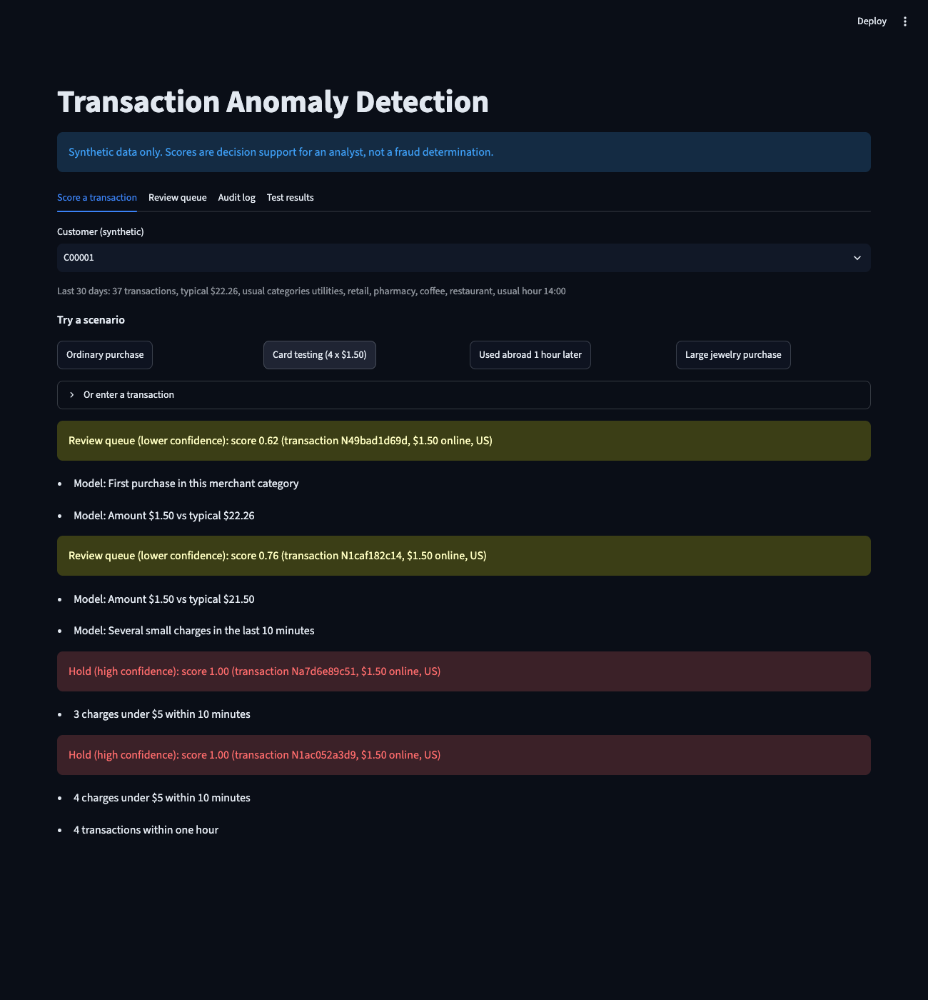
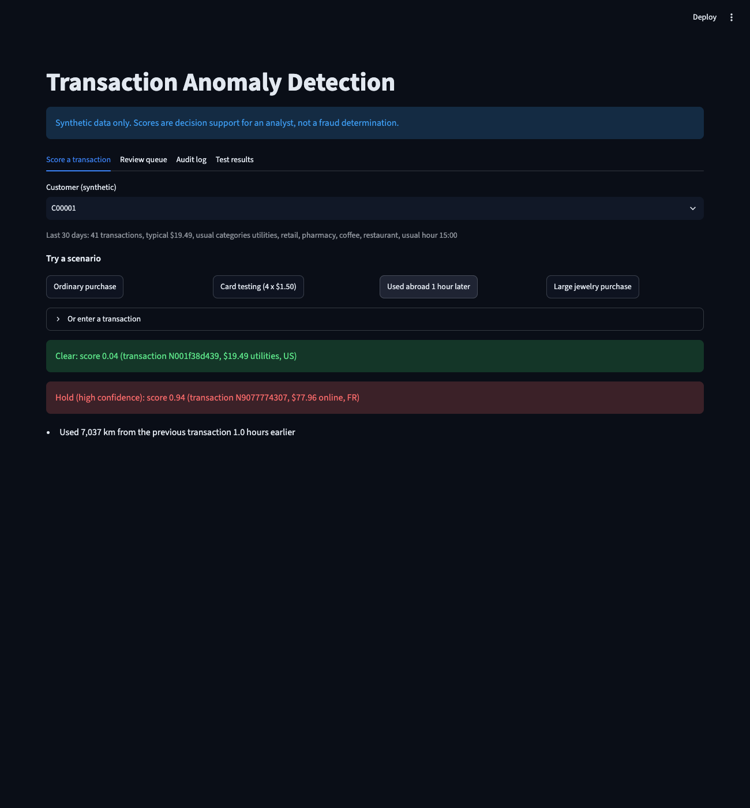
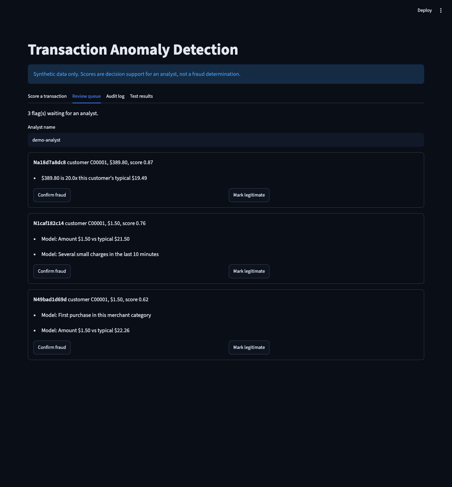
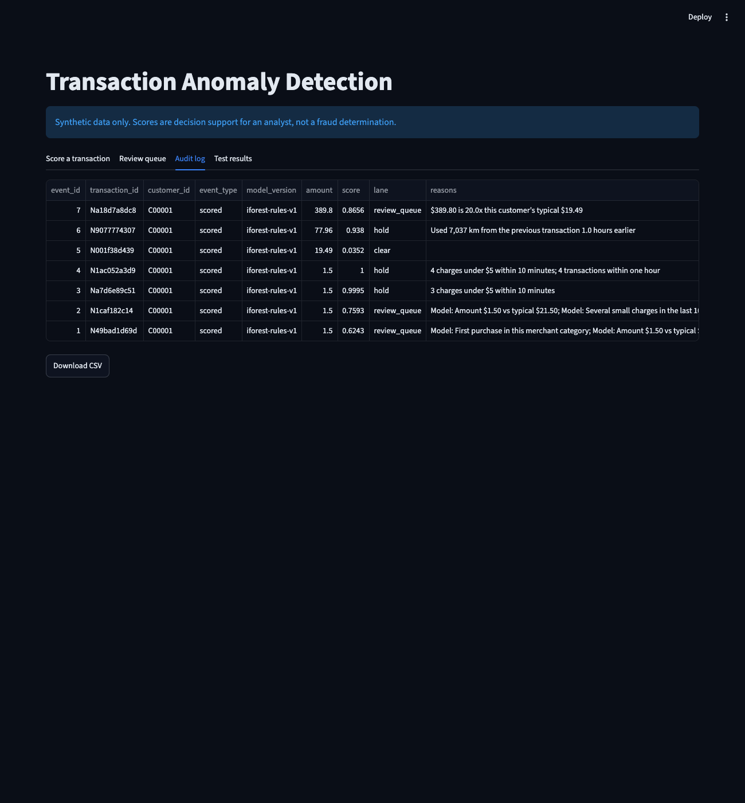
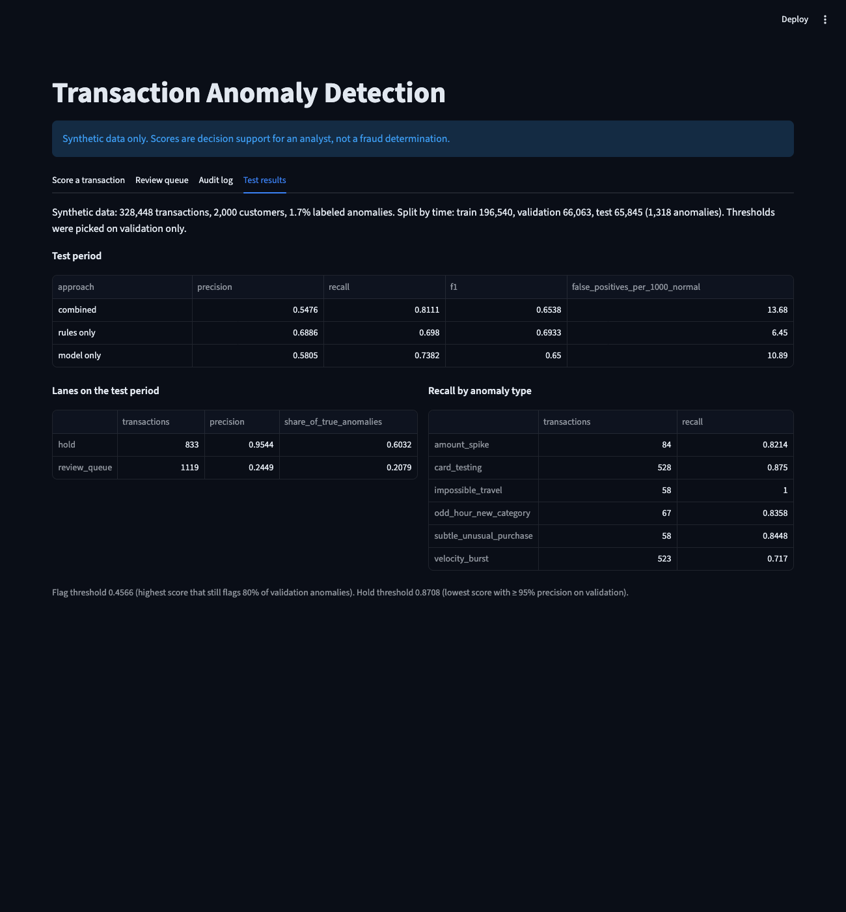
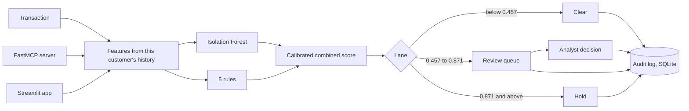

# Transaction Anomaly Detection


**Status: In progress.** The detector, review queue, audit log, Streamlit app and MCP server all run
locally today. There is no hosted demo.

Independent reference project by Shoot It Analytics LLC. Built with public or synthetic data.

## What it does

1. Scores each card transaction against that customer's own history using an Isolation Forest model
   and five plain rules (amount spike, impossible travel, card testing, velocity, night purchase in a
   new category).
2. Combines model and rules into one score from 0 to 1 and gives every flag a reason a person can
   read, for example "4 charges under $5 within 10 minutes" or "Used 7,037 km from the previous
   transaction 1.0 hours earlier".
3. Routes each transaction to one of three lanes: **clear**, **review queue** (flagged, lower
   confidence, a person decides) or **hold** (flagged, high confidence).
4. Writes every score and every analyst decision to an append-only audit log.
5. Exposes the same functions through a read-only FastMCP server so an AI assistant can score
   transactions, read the queue and read each transaction's audit trail.

All data is synthetic and generated by this repo.



| Impossible travel | Review queue |
|---|---|
|  |  |

| Audit log | Test results |
|---|---|
|  |  |

## Why I built this

**The problem.** Card fraud teams work from alert queues. Rules alone are easy to explain but miss
anything they were not written for; models catch more but produce scores nobody can explain, and
both produce far more alerts than a team can read. The practical question is not "is this fraud"
but "which alerts can be acted on automatically, which need a person, and why was each one raised".

**What I set out to prove.** Whether a small, explainable detector (an unsupervised model plus a
handful of rules) can split alerts into a high-precision lane that is safe to act on automatically
and a lower-confidence lane for people, with a plain reason on every alert, measured on data it was
not tuned on.

**Key design decisions**
- **Data:** synthetic transactions with six labeled fraud patterns and deliberate hard negatives
  (legitimate large purchases and real trips abroad), so the detector cannot score well by flagging
  anything unusual.
- **Model:** Isolation Forest on per-customer features (amount vs the customer's typical amount,
  time of day, distance, travel speed, recent counts, new category). Features use only earlier
  transactions, so nothing leaks from the future.
- **Combining model and rules:** both are calibrated on a validation period (model score to an
  estimated probability, each rule to its measured precision) and combined as `1 - product(1 - p)`.
  Before calibration the rules contributed nothing, because they were on a different scale.
- **Thresholds:** picked on the validation period only. The flag threshold keeps 80% recall; the hold
  threshold is the lowest score with at least 95% precision. Everything in between goes to people.
- **Cost:** runs on a laptop CPU, no paid services. Training takes about 1 minute after the data is
  generated.

**Results.** Measured on a later 18-day test period the detector never saw (details below): the hold
lane was 95.4% precise and caught 60.3% of anomalies; together with the review queue, 81.1% of
anomalies were flagged, with 13.7 false alerts per 1,000 normal transactions.

**Limits.** Synthetic data only; never used with real customers or real card data. Not a certified
or regulated product, and not a fraud decision system: scores support an analyst.

**What I'd do next in a real deployment.** Train and validate on labeled historical data, tune the
review threshold to the team's real capacity, feed analyst decisions back as labels, monitor for
drift, and get model risk review before any automated hold.

## Architecture



| Piece | File |
|---|---|
| Synthetic data generator | `anomaly/generate.py` |
| Features (past-only) | `anomaly/features.py` |
| Rules and their reasons | `anomaly/rules.py` |
| Model, calibration, lanes, reasons | `anomaly/detector.py` |
| Training and evaluation | `anomaly/train.py` -> `artifacts/metrics.json`, `artifacts/detector.joblib` |
| Scoring service used by app and MCP | `anomaly/service.py` |
| Audit log | `anomaly/audit.py` |
| MCP server | `mcp_server.py` |
| App | `app.py` |

The trained detector and the last 30 days of synthetic history (`data/recent_history.csv.gz`,
2.9 MB) are committed so the app and MCP server start without regenerating data.

## How to run

Python 3.11.

```bash
python -m venv .venv && source .venv/bin/activate
pip install -r requirements-dev.txt
streamlit run app.py
pytest
```

MCP server (stdio):

```bash
python mcp_server.py
```

Tools: `detect_transaction_anomaly`, `investigate_customer_pattern`, `analyze_merchant_risk`,
`get_investigation_queue`, `get_audit_trail`, `get_system_metrics`. Resources: `model://detector`,
`data://risk_thresholds`. Prompt: `fraud_investigation`.

All six tools are read-only and deterministic, and none calls a language model: the same request
returns the same answer. Scores and analyst decisions are written to the audit log by the Streamlit
app; the MCP server only reads them.

Regenerate the data and retrain (about 2 minutes for data and 1 minute for training on a 2-core laptop):

```bash
python -m anomaly.generate     # 328,448 transactions -> data/transactions.csv
python -m anomaly.train        # writes artifacts/ and prints the test results
```

## Measured results

**How measured.** `python -m anomaly.train` on the generated data (seed 7): 2,000 synthetic customers,
90 days, 328,448 transactions, 1.7% labeled anomalies. Split by time: days 0-53 train the model,
days 54-71 calibrate it and pick thresholds, days 72-89 are the test period (65,845 transactions,
1,318 anomalies). Retraining reproduces the same numbers.

Test period:

| Approach | Precision | Recall | F1 | False alerts per 1,000 normal |
|---|---|---|---|---|
| Model and rules combined (flag threshold) | 0.548 | 0.811 | 0.654 | 13.7 |
| Rules only | 0.689 | 0.698 | 0.693 | 6.5 |
| Model only | 0.581 | 0.738 | 0.650 | 10.9 |

By lane:

| Lane | Transactions | Precision | Share of all anomalies |
|---|---|---|---|
| Hold | 833 | 0.954 | 60.3% |
| Review queue | 1,119 | 0.245 | 20.8% |

Recall by anomaly type: impossible travel 1.00, card testing 0.88, odd hour in a new category 0.84,
subtle unusual purchase 0.84, amount spike 0.82, velocity burst 0.72.

Reading these numbers: the combined detector flags more anomalies than either part alone (81% vs
70% and 74%) at lower overall precision, because it is tuned to send uncertain cases to people
instead of dropping them. The part that acts without a person, the hold lane, met the 95% precision
target on the test period.

Tests: 23 pytest tests (generator, past-only features, each rule, calibration, lanes, audit log,
scoring service, all six MCP tools through an in-memory client, and the Streamlit app). CI also runs
ruff and scans the git history with gitleaks.

## Limits

- Synthetic data. Real fraud is rarer, more varied and changes over time.
- The night rule looks better than it would on real data: synthetic customers never shop between
  1am and 5am, so that rule measured 98.8% precise on validation.
- The amount spike rule measured only 31% precise on validation, because the data includes
  legitimate large purchases on purpose. The model and other signals carry most of that weight.
- The review queue holds about 62 alerts a day for 2,000 customers at 24.5% precision. Whether that
  is acceptable depends on the team reviewing it.
- Analyst decisions are logged but not yet fed back into training.
- No authentication in the app or MCP server.

## What's next

- Feed analyst decisions back as labels and measure the change.
- Add merchant-level features (new merchant, merchant risk) to the generator and model.
- Drift monitoring on the score distribution.
- A hosted demo.


## License

MIT, see [LICENSE](LICENSE).
